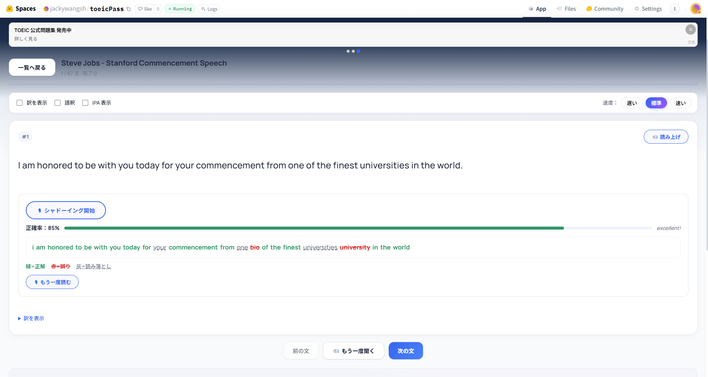
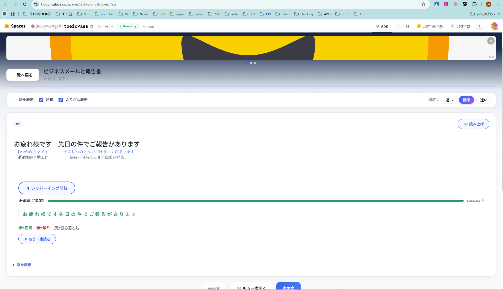
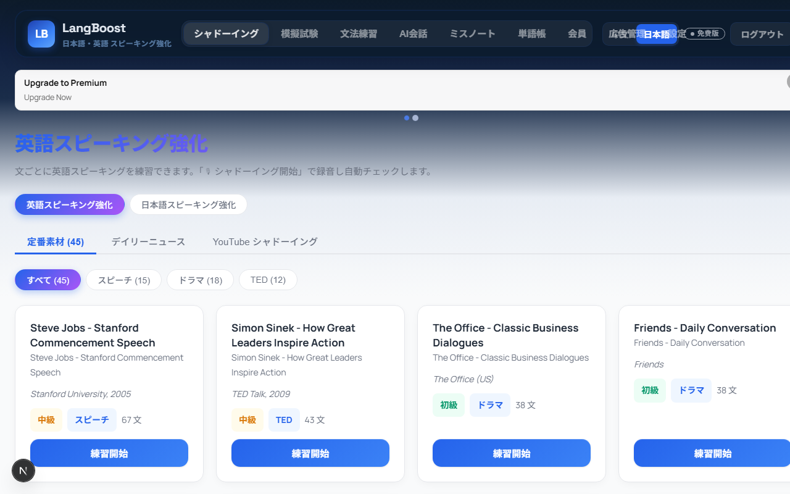
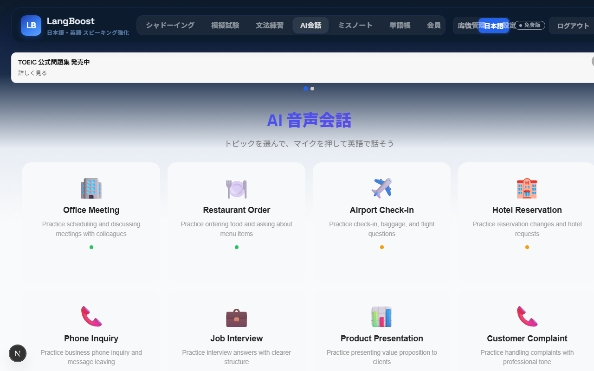

# LangBoost — Japanese & English Speaking Practice Platform

[**Live Demo on Hugging Face**](https://huggingface.co/spaces/jackywangsh/toeicPass) · [**GitHub**](https://github.com/zixuniaowu/toeicPass)

An AI-powered multilingual speaking practice platform with sentence-by-sentence shadowing, tap-to-translate, pronunciation feedback, grammar drills, vocabulary flashcards, mock exams, and AI conversation.

---

## Key Features

### Shadowing Training

The core feature of LangBoost is **sentence-by-sentence shadowing** with real-time pronunciation correction for both Japanese and English.

#### English Shadowing — Pronunciation Feedback

Record your voice and instantly see color-coded feedback: **green** = correct, **red** = mispronounced, gray = missed. The accuracy score shows your progress.



> *Steve Jobs' Stanford Speech — "bio" was mispronounced (should be "one"), "university" was misread. Accuracy: 85%*

#### Japanese Shadowing — Furigana & Translation

Japanese sentences display **furigana** (reading annotations) above kanji and **Chinese translations** below. Toggle these on/off with checkboxes.



> *Business email practice — full furigana + Chinese translation displayed, 100% pronunciation accuracy*

#### More Shadowing Features

- **YouTube Shadowing** — Auto-fetch subtitles from any YouTube video for sentence-by-sentence repeat-after practice
- **Tap-to-Translate** — Tap any word to see its translation and hear its pronunciation
- **English IPA Phonetics** — Per-word IPA transcription displayed inline
- **Cinema Mode** — Immersive split-screen with video + highlighted subtitles
- **Speed Control** — Slow / Normal / Fast playback for each sentence
- **Curated Content** — TED Talks, news, drama dialogues, famous speeches (Steve Jobs, Simon Sinek, etc.)



### AI Conversation



### AI Conversation

Practice real-world scenarios with AI-powered dialogue:

- Office meetings, restaurant orders, airport check-in, job interviews, and more
- Multi-turn conversation with real-time speaking practice
- AI-driven error analysis and explanations

### TOEIC Exam Prep

- Part 1–7 section practice with adaptive difficulty
- Full mock exams with score conversion and per-section feedback
- Mistake notebook with spaced repetition cards
- Score prediction and plateau alerts

### Vocabulary & Grammar

- SRS-based flashcards for vocabulary review
- Grammar drills with structured exercises
- Spaced repetition scheduling for optimal retention

### Learning Analytics

- Accuracy, pace, and retention trends per section
- Score prediction using recent mock data and error distribution
- Schedule deviation and plateau alerts

---

## Screenshots

| English Pronunciation Feedback | Japanese Furigana + Translation |
|:---:|:---:|
|  |  |

| Shadowing Library | AI Conversation Scenarios |
|:---:|:---:|
|  |  |

---

## Architecture

```
langboost/
├── apps/
│   ├── api/               NestJS REST API (port 8001)
│   ├── mobile/            Expo / React Native mobile app
│   └── web/               Next.js 15 frontend (port 8000)
├── packages/
│   ├── app-core/          Shared app-facing API client + data contracts
│   ├── ad-system/         Ad placement system
│   ├── conversation-ai/   AI conversation engine
│   └── shared/            Shared types & utilities
├── db/                    PostgreSQL schema + migrations
└── docs/                  Architecture & design docs
```

| Layer | Stack |
|-------|-------|
| API | NestJS, TypeScript, JWT + RBAC, multi-tenant |
| Web | Next.js 15, React, CSS Modules |
| Mobile | Expo 56, React Native, Android-first / iOS-ready |
| DB | PostgreSQL 15+ (PGLite for tests) |
| Analytics | Umami (privacy-friendly) |
| CI/CD | GitHub Actions → Hugging Face Spaces |
| Container | Docker (Node 20) |

---

## Getting Started

```bash
# Install dependencies
npm install

# Start dev servers (workspace packages + API + Web)
npm run dev

# Or start individually
npm run dev:packages # Workspace package watch mode
npm run dev:api      # API only (port 8001)
npm run dev:web:hot  # Web only (port 8000)
npm run dev:mobile   # Mobile app (Expo)
```

| URL | Description |
|-----|-------------|
| `http://localhost:8000` | Web frontend |
| `http://localhost:8001/api/v1` | REST API |
| Expo QR / Android emulator | Mobile frontend |

## Commands

| Command | Description |
|---------|-------------|
| `npm run dev` | Development mode (workspace packages + API + Web) |
| `npm run dev:packages` | Watch and rebuild reusable workspace packages |
| `npm run build` | Production build |
| `npm run build:packages` | Build reusable workspace packages only |
| `npm run dev:mobile` | Start Expo mobile app |
| `npm run android:mobile` | Start Expo and open the Android target |
| `npm run ios:mobile` | Start Expo and open the iOS target |
| `npm run run:android:mobile` | Run the generated native Android app |
| `npm run run:ios:mobile` | Run the generated native iOS app |
| `npm run prebuild:mobile` | Generate native Android/iOS projects from Expo config |
| `npm run build:mobile:android:preview` | EAS internal Android APK build with preview app id |
| `npm run build:mobile:android:production` | EAS production Android AAB build |
| `npm run build:mobile:ios:preview` | EAS internal iOS preview build |
| `npm run build:mobile:ios:simulator` | EAS iOS simulator build |
| `npm run build:mobile:ios:production` | EAS production iOS build |
| `npm test` | Run test suite |
| `npm run lint` | Build packages and type-check the monorepo |
| `npm run typecheck:packages` | Type-check reusable workspace packages only |
| `npm run db:migrate` | Run database migrations |

## Mobile Packaging

`apps/mobile` now includes Expo EAS build profiles and a dynamic app config.

- `development`
  - Android APK development-client build
  - package / bundle id suffix: `.dev`
  - scheme: `toeicpass-dev`
- `preview`
  - internal preview build for Android and iOS
  - package / bundle id suffix: `.preview`
  - scheme: `toeicpass-preview`
- `production`
  - store-ready package identifiers
  - scheme: `toeicpass`

This lets internal Android installs, iOS preview installs, and production builds coexist without rewriting app identifiers later.

The mobile app can also switch API targets at runtime from the login page or settings page. That covers:

- Hugging Face production API
- a LAN dev API such as `http://192.168.x.x:8001/api/v1`
- future iOS preview/test environments without rebuilding the app

Both the login page and the settings page can now run an in-app API connectivity check against `/health`, so device builds can confirm the backend target before attempting auth or loading training data.

Those screens also show runtime diagnostics for the current build variant, platform, scheme, app identifier, and API probe result, which makes Android preview and future iOS preview installs much easier to debug on-device.

The shadowing flow now also reuses a shared transcript-comparison engine from `packages/app-core`, so the existing web compare logic is no longer web-only. Mobile can already render the same compare feedback shape, and future Android/iOS speech-recognition integrations can feed that shared result pipeline instead of inventing a second comparison implementation.

If you want device-friendly API presets to appear automatically in the mobile app, you can also provide:

- `EXPO_PUBLIC_LAN_API_URL`
  - example: `http://192.168.1.23:8001/api/v1`
- `EXPO_PUBLIC_PREVIEW_API_URL`
  - example: `https://staging.example.com/api/v1`

```bash
# Internal Android APK
npm run build:mobile:android:preview

# Store-ready Android AAB
npm run build:mobile:android:production

# iOS simulator build
npm run build:mobile:ios:simulator
```

## Environment Variables

| Variable | Default | Description |
|----------|---------|-------------|
| `PORT` | `8001` | API listen port |
| `JWT_SECRET` | `dev-secret` | JWT signing key |
| `WEB_ORIGIN` | `http://localhost:3000` | CORS allowed origin |
| `DATABASE_URL` | — | PostgreSQL connection string |
| `NEXT_PUBLIC_UMAMI_WEBSITE_ID` | — | Umami analytics website ID |
| `EXPO_PUBLIC_LAN_API_URL` | — | Optional LAN API preset shown in the mobile app |
| `EXPO_PUBLIC_PREVIEW_API_URL` | — | Optional preview API preset shown in the mobile app |

## Deployment

### Docker

```bash
docker build -t langboost .
docker run -p 7860:7860 langboost
```

### Hugging Face Spaces

Every push to `main` auto-syncs to Hugging Face Spaces.

Required GitHub secrets: `HF_TOKEN`, `HF_REPO_ID`

## Documentation

- [System Blueprint](docs/system-blueprint.md) — Architecture and product goals
- [Mobile Architecture](docs/mobile-architecture.md) — Android-first reuse strategy and next iOS path
- [API Contract](docs/api-contract-v1.md) — REST API specification
- [Official Question Sources](docs/official-question-sources.md) — Licensed content guidelines

## License

[Business Source License 1.1 (BUSL-1.1)](LICENSE)

You may view, fork, and modify the code for non-commercial purposes (personal learning, academic research, contributions). Commercial use requires a separate license. On **April 18, 2029**, the license automatically converts to Apache 2.0.
